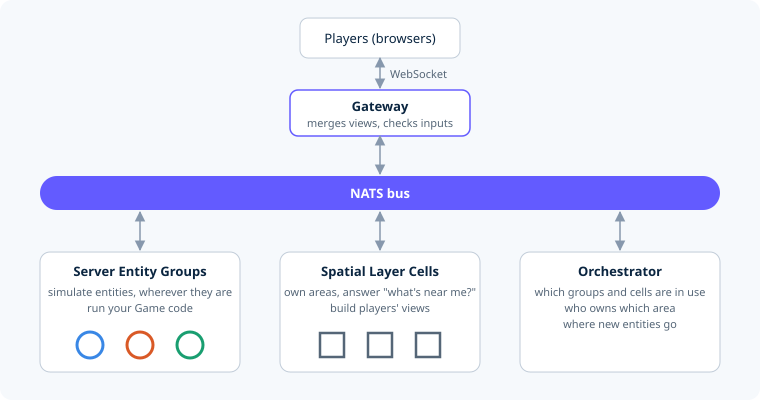

A Worldmesh world is a set of processes that talk over [NATS](https://nats.io). Every process runs the same binary (your game's), started in one of four roles.

## Server Entity Groups

A group simulates a set of entities: players, bots, monsters, projectiles, anything your game spawns. Each entity lives in exactly one group at a time, wherever it stands on the map. Every tick, the group:

1. delivers the actions and commands that arrived since its last tick,
2. runs your systems, stage by stage, for each of its entities (with the player's inputs due that tick),
3. reports its entities to the Spatial Layer Cells whose areas they stand in, with each one's kind and visible components and any "what's near me?" questions,
4. sends what its entities did: actions, events, spawns, and any entities it was told to hand off.

A group process can run any number of groups (the orchestrator asks it to start or stop them). Groups are where your game's simulation runs, and the only place it runs.

## Spatial Layer Cells

A cell owns an area: a set of chunks (`WorldConfig::chunk_size` tiles square). It simulates nothing. Every tick each group sends it a report listing that group's entities in its area, and from those copies the cell:

- answers "what's near me?" questions, back to the asking group before its next tick,
- passes actions aimed at an area on to every group with an entity in the circle,
- builds each player's view of its area for the gateway.

Everything a cell holds is rebuilt from the reports every tick. Moving area from one cell to another hands off nothing: the groups just send their next reports to the new owner.

## The orchestrator

The orchestrator decides which groups and cells are in use and which cell owns which chunk, and publishes that as the **assignment**. It also places new entities: players who join, and entities the game spawns (which it gives ids). Entities are split between groups by count while keeping neighbours together: sorted along a Hilbert curve, cut into equal runs, each run given to the group already holding most of it.

It never sees game traffic and never runs game code.

## Gateways

A gateway holds players' WebSockets. It:

- welcomes each player (your world's welcome values, its config, and the names of its components, messages and kinds) and asks the orchestrator to place them (your `join` function),
- checks each input and command against your types (an input that doesn't parse as your input type, or a command whose name isn't a registered command or whose data doesn't parse, is dropped) and sends it to the player's entity, wherever it is,
- every tick, tells the cells where each player is looking, merges the views they send back, and sends each player a snapshot: compact binary with only what changed, or JSON.

## What happens in one tick

At 10 ticks per second, every 100 ms:

| When | Where | What |
| --- | --- | --- |
| Tick boundary | Every group | Deliver what arrived, run `tick` for every entity, publish reports and actions |
| A few ms later | Every cell | Has every group's report; answers questions, passes on area actions, builds views |
| A few ms later | Gateway | Has every cell's views; merges them per player; sends snapshots |
| Before the next boundary | Groups | Have the actions and answers sent this tick, ready for the next one |

Cells wait at most 40 ms for groups' reports, and the gateway at most 60 ms for cells' views, so a slow process delays its own part, not everyone's.

## The bus

Everything goes through NATS, as MessagePack (or JSON, switchable live for debugging). Subjects:

| Subject | From, to | What |
| --- | --- | --- |
| `entity.<id>` | anyone to the entity's group | inputs, commands, actions for one entity |
| `group.<id>.inbox` | anyone to one group | handoffs, forwards, area actions passed on by cells |
| `group.all.inbox` | groups to every group | actions sent to everyone |
| `group.<id>.senses` | cells to one group | answers to "what's near me?" |
| `spatial.<id>.reports` | groups to one cell | each tick's report |
| `spatial.<id>.inbox` | groups to one cell | actions aimed at an area |
| `spatial.viewers` | gateway to cells | where players are looking |
| `gateway.views` | cells to gateways | players' views |
| `control.*` | various | heartbeats, assignments, joins, spawns, commands, stats |

Because each entity has its own subject, nobody needs to know which group simulates it: the bus delivers to whoever subscribes, and a group subscribes to exactly the entities it holds (plus, for a second after a handoff, the ones it just gave away, to forward strays).
