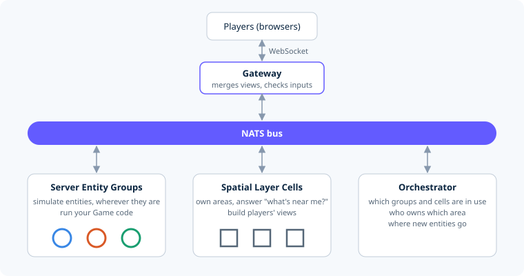

import TickSteps from '../../../components/diagrams/TickSteps.astro';

A Worldmesh world is a set of processes that talk over [NATS](https://nats.io). They all run your game's binary, each in one of four roles.

## Server Entity Groups

A group simulates a set of entities: players, bots, monsters, projectiles, anything your game spawns. Each entity is in exactly one group at a time, wherever it stands. Groups are the only place your game code runs.

Every tick, a group:

1. delivers the actions and commands that arrived since its last tick,
2. runs your systems, stage by stage, for each of its entities, with its player's inputs due that tick,
3. reports its entities to the cells whose areas they stand in: kind, visible components, and any "what's near me?" questions,
4. sends what its entities did: actions, events, spawns, and entities it was told to hand off.

A group process runs as many groups as the orchestrator asks for.

## Spatial Layer Cells

A cell owns an area: a set of chunks, each `chunk_size` tiles square. It simulates nothing. From the reports groups send every tick, it:

- answers "what's near me?" questions, back to the asking group before its next tick,
- passes actions aimed at an area to every group with an entity in range,
- builds each player's view of its area, for the gateway.

A cell rebuilds everything from the reports every tick. So moving an area to another cell hands nothing off: groups just send their next reports to the new owner.

## The orchestrator

The orchestrator decides which groups and cells are in use and which cell owns each chunk, and publishes that as the **assignment**. It also places new entities: players who join, and entities your game spawns (it gives those their ids). It splits entities between groups by count while keeping neighbors together; [Scaling and handoffs](/Worldmesh/concepts/scaling/) shows how.

It never sees game traffic and never runs game code.

## Gateways

A gateway holds players' WebSockets. It:

- welcomes each player with your welcome values, the world config and the schema (the names of your components, messages and kinds), and asks the orchestrator to place them with your `join` function,
- checks every input and command against your types, drops anything that doesn't parse or isn't a registered command, and sends the rest to the player's entity, wherever it is,
- every tick, tells the cells where each player is looking, merges the views they send back, and sends each player a snapshot.

## One tick

At the default 10 ticks per second, all of this happens every 100 ms. Step through it:

<TickSteps />

A slow process only delays its own part: cells wait at most 40 ms for reports, and the gateway at most 60 ms for views.

## The bus

Everything goes over NATS as MessagePack. JSON can be switched on live, for reading the traffic.

Each entity has its own subject, so nobody needs to know which group simulates it. A group subscribes to exactly the entities it holds, plus, for a second after a handoff, the ones it just gave away, so it can forward anything that still arrives for them.

| Subject | From, to | Carries |
| --- | --- | --- |
| `entity.<id>` | Anyone to the entity's group | Inputs, commands and actions for one entity |
| `group.<id>.inbox` | Anyone to one group | Handoffs, forwards, area actions passed on by cells |
| `group.all.inbox` | Groups to every group | Actions sent to everyone |
| `group.<id>.senses` | Cells to one group | Answers to "what's near me?" |
| `spatial.<id>.reports` | Groups to one cell | Each tick's report |
| `spatial.<id>.inbox` | Groups to one cell | Actions aimed at an area |
| `spatial.viewers` | Gateway to cells | Where players are looking |
| `gateway.views` | Cells to gateways | Players' views |
| `control.*` | Various | Heartbeats, assignments, joins, spawns, commands, stats |
