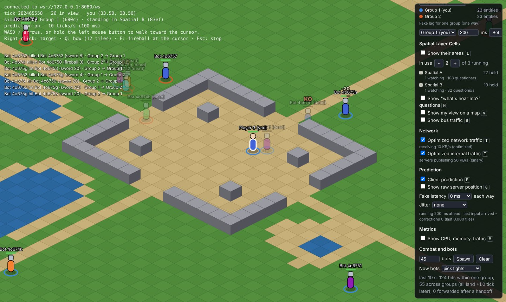

The medieval example is a complete game on Worldmesh: a walled town, swords, bows, fireballs, and bots that wander, pick fights and fight back. It's the quickest way to see what the library does.

## Start it

### With Docker

From the repository root:

```sh
make example
```

This starts NATS, the orchestrator, two group processes, three Spatial Layer Cells, a gateway and the client. Open [localhost:5173](http://localhost:5173). Open a second tab for a second player.

Stop it with `make down`.

### Without Docker

You need Rust 1.87 or newer, Node 22, and a [NATS server](https://docs.nats.io/running-a-nats-service/introduction/installation) on port 4222.

```sh
cargo build --release -p medieval
M=target/release/medieval
$M orchestrator --groups 2 --spatial 2 &
$M group & $M group &
$M spatial & $M spatial & $M spatial &
$M gateway --listen 0.0.0.0:8080 --allow-debug &

npm install
npm run dev -w medieval-client
```

## Play

| Key | What it does |
| --- | --- |
| WASD, arrow keys, or hold the left mouse button | Walk |
| Right-click a unit | Target it. Your weapon keeps firing while it's in reach. |
| Q | Switch between sword and bow |
| F | Throw a fireball at the cursor |
| Esc | Drop your target |

## Look inside



The panel on the right is `@worldmesh/debug`. Try these:

1. Under **Combat and bots**, spawn 200 bots that pick fights. A hit between units in different groups shows an orange note (`Group 1 → Group 2`): the arrow crossed the bus and still landed one tick later.
2. Raise **Groups** to 4. Entities are re-split and handed off live. Their rings change color and nobody stops moving.
3. Raise **Spatial Layer Cells** and watch the areas shaded on the ground re-split. Nothing is handed off: groups just report to the new owners.
4. Press **B** for the bus view: every process around NATS, and every message between them.
5. Set **Fake lag** on your own group to 300 ms. Your unit still answers your keys at once (that's prediction), and the rest of the world keeps its pace.
6. Press **M** for CPU, memory and traffic per process.

The [debug panel guide](/Worldmesh/guides/debug-panel/) lists every control.
