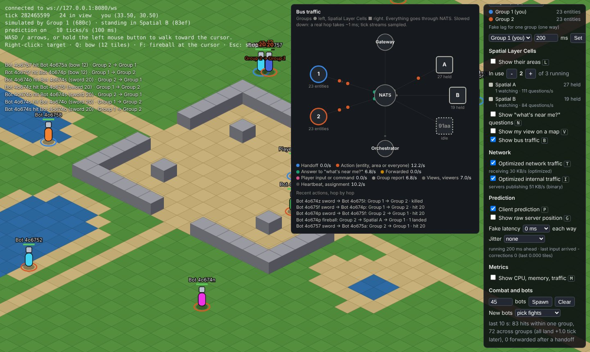

`@worldmesh/debug` is a panel for development. It shows who simulates what and whose area is whose, scales the world, adds fake lag to one server at a time, and draws every message crossing the bus.

```ts
import { DebugPanel } from '@worldmesh/debug';

const panel = new DebugPanel({
  client, // your WorldmeshClient
  // An overlay was switched: groups, spatial, senses, view or ghosts.
  onOverlay: (overlay, on) => redrawOverlays(),
});
```

:::caution
The scaling and lag controls only work when the gateway runs with `--allow-debug`. Never use that flag in production: any connected player could use them.
:::

## What it shows



| Section | What's there |
| --- | --- |
| Server Entity Groups | Groups in use (type any number), entities per group, regroup by position, fake lag for one group |
| Spatial Layer Cells | Cells in use, entities and players per cell, questions per second |
| Network | Compact or JSON snapshots, MessagePack or JSON on the bus, bytes per second each way |
| Prediction | On or off, how far ahead you run, how early your last input arrived, corrections |
| Metrics | CPU, memory, traffic and load per process, over the last minute |
| Bus traffic | Every process around NATS, messages moving between them, recent actions traced hop by hop |

Add your own sections with `panel.addSection(title)`, which returns an element to fill. The medieval example puts its bot controls there.

## Keys

| Key | Toggles |
| --- | --- |
| <kbd>O</kbd> | Color entities by group |
| <kbd>L</kbd> | Spatial Layer Cell areas |
| <kbd>N</kbd> | "What's near me?" questions |
| <kbd>V</kbd> | Your view, on a minimap |
| <kbd>G</kbd> | Raw server positions (ghosts) |
| <kbd>P</kbd> | Prediction |
| <kbd>T</kbd> | Compact snapshots |
| <kbd>I</kbd> | MessagePack on the bus |
| <kbd>B</kbd> | Bus view |
| <kbd>M</kbd> | Metrics |

## Drawing overlays

The panel doesn't draw on your world; your renderer does. The panel keeps the overlays' state in `panel.overlays` (`groups`, `spatial`, `senses`, `view`, `ghosts`) and calls `onOverlay` when one changes.

For colors and names that match its legends, use `panel.groupColor(id)`, `panel.groupName(id)`, `panel.spatialName(id)` and `panel.short(id)`. `panel.minimap` is a canvas shown while the view overlay is on.

The data comes from the client: `entity.state.group` and `.spatial`, `client.assignment` (which cell owns each chunk), the `senses` in each snapshot (the questions asked, while debug traffic is on), and the client's `handoff` handler.

## Tracing actions

The bus view lists recent actions hop by hop, like `Player 3 bow → Bot k3x: Gateway → Group 1 → Group 2 · hit 12`. Tell it which of your events start and end a trace:

```ts
new DebugPanel({
  client,
  traceNote: (ev) =>
    ev.k === 'used'
      ? {
          trace: ev.trace,
          start: { label: `${name(ev.actor)} ${ev.ability}`, group: ev.group },
        }
      : {
          trace: ev.trace,
          result: { text: ev.outcome, landed: ev.outcome === 'hit' },
        },
});
```

Everything one action leads to shares its trace id: `me.send` returns it, and `Incoming::trace` carries it on the receiving side.
